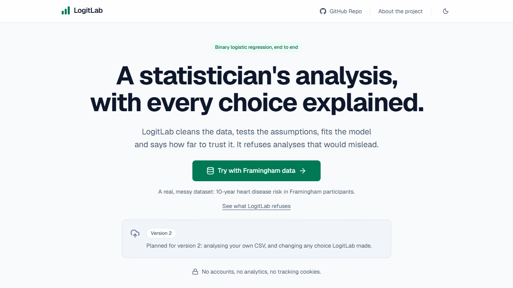
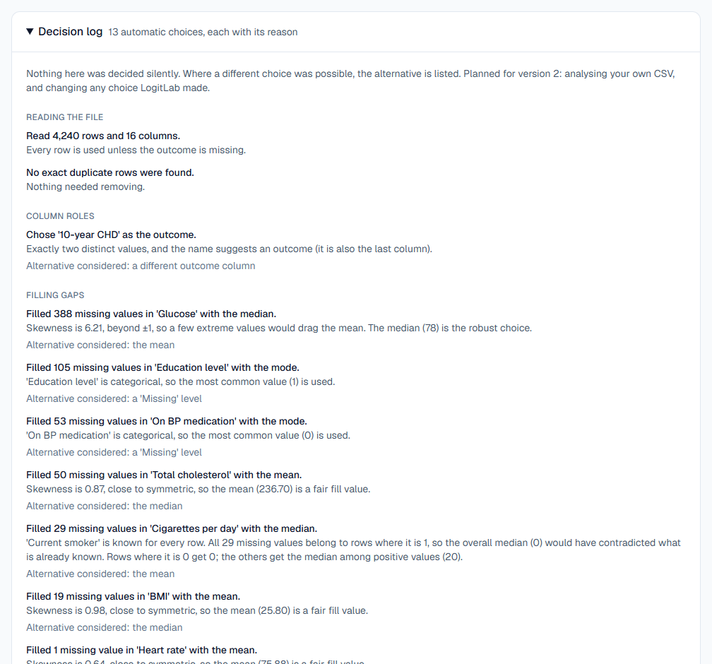
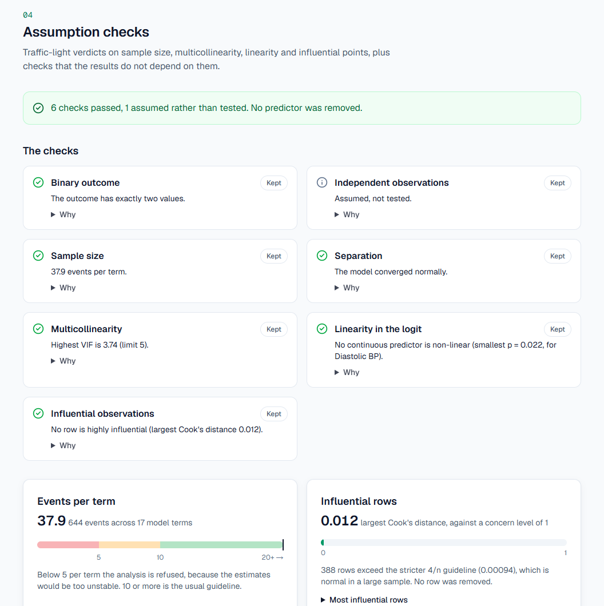
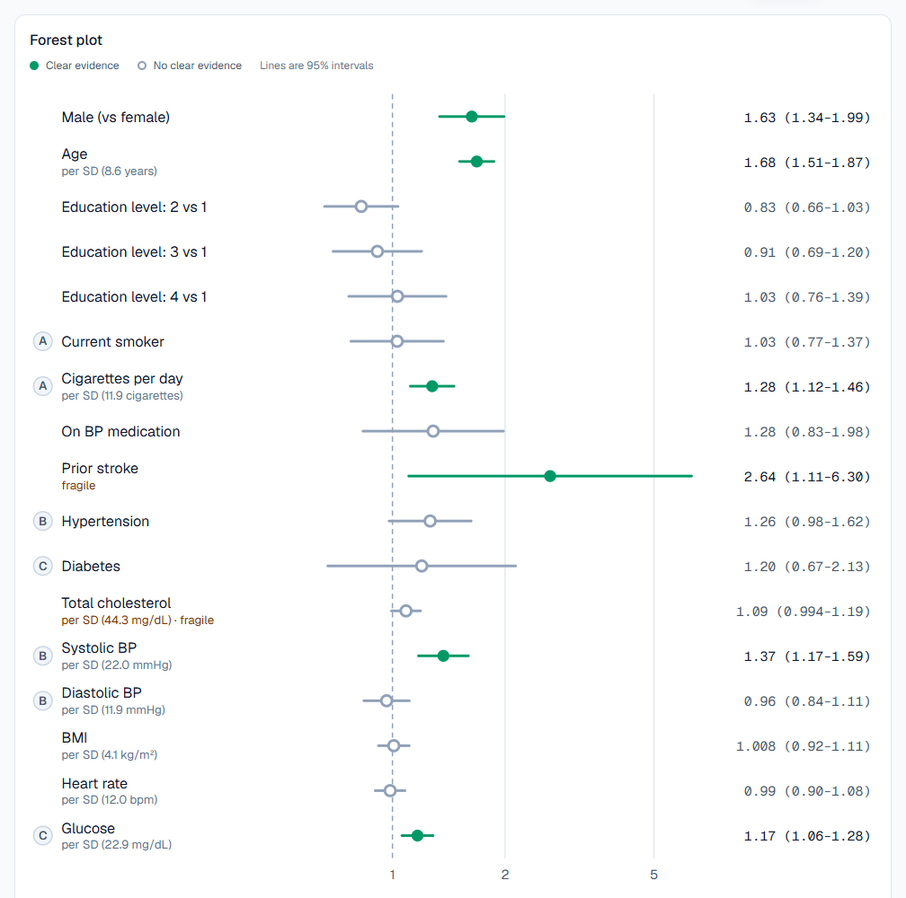
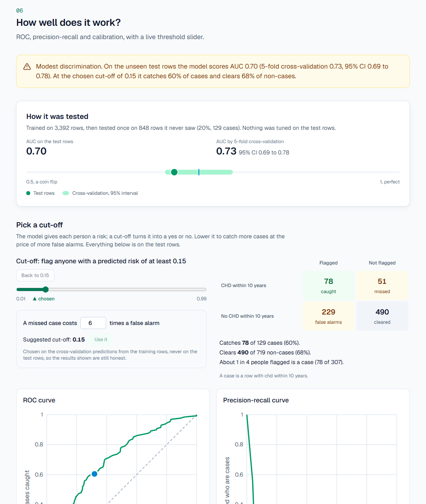
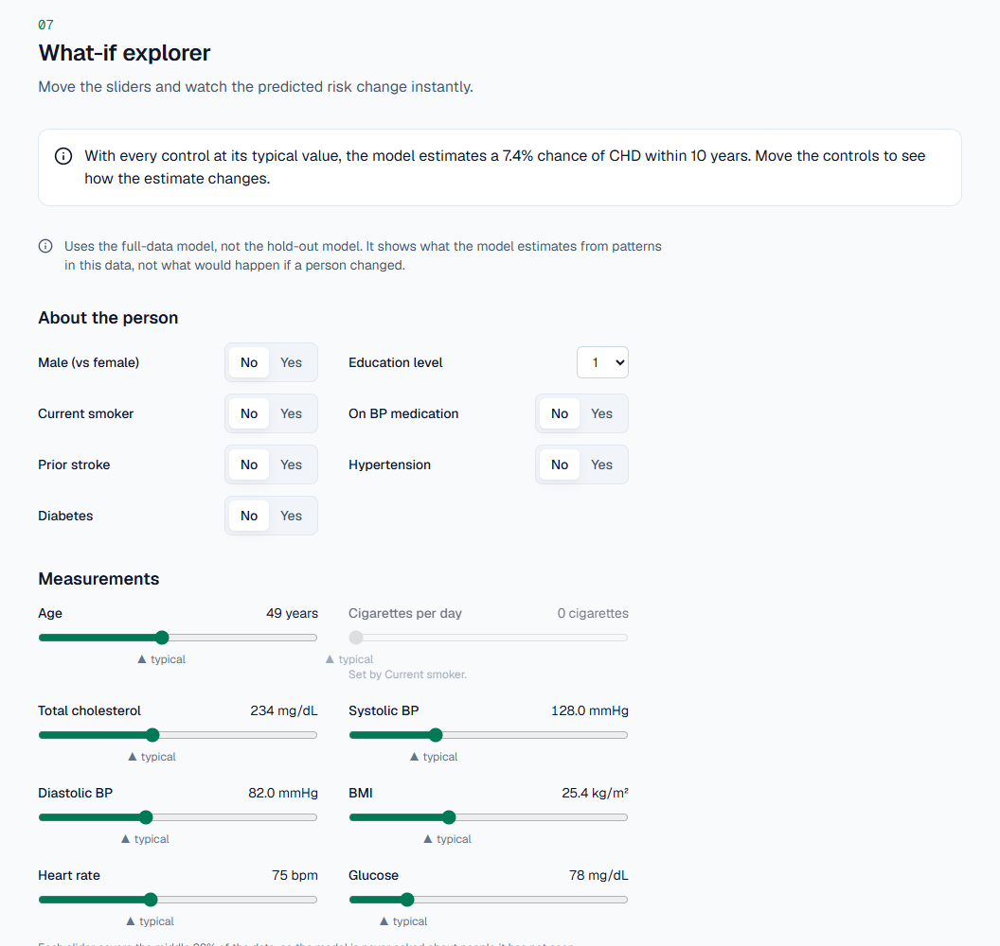
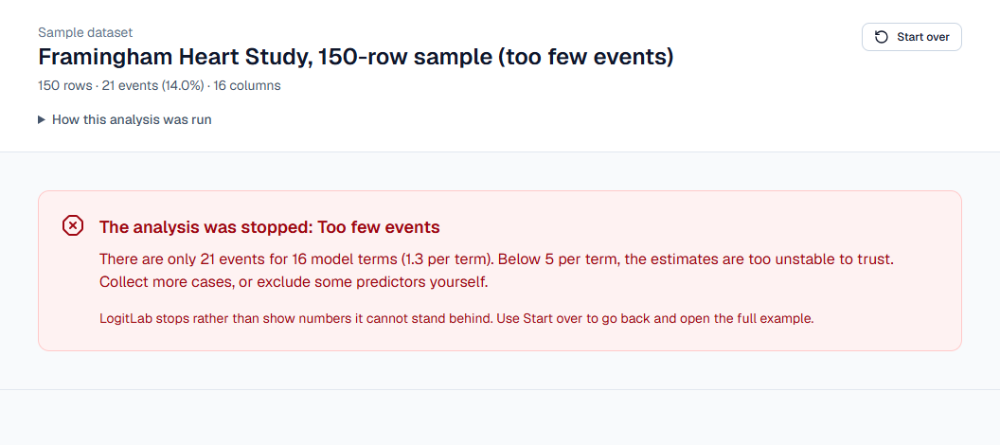

# LogitLab

A guided binary logistic regression, end to end. LogitLab cleans the data, tests the assumptions, fits the model, says how far to trust it and refuses analyses that would mislead. Every automatic choice is logged with its reason.

**Live: [logitlab.vercel.app](https://logitlab.vercel.app/)**. Choose **Try with Framingham data** to open the full example in one click.



## Status

- **Version 1 (live now):** a complete, guided analysis of one prepared example, the Framingham Heart Study dataset, with all eight report sections working. A second example, "See what LogitLab refuses", shows the engine stopping on purpose.
- **Version 2 (not built yet):** the Python engine behind an API, and two more example datasets.

> Planned for version 2: analysing your own CSV, and changing any choice LogitLab made.

Nothing in version 1 runs Python at request time: the example results are generated ahead of time by the engine and shown by the web app.

## What the eight sections deliver

| #   | Section                | What you get                                                                                                                                    |
| --- | ---------------------- | ----------------------------------------------------------------------------------------------------------------------------------------------- |
| 1   | Your data at a glance  | Detected column roles, a suggested target, and flags for ID, constant and leaky columns.                                                        |
| 2   | Data hygiene           | Missing values, how each gap was filled, and a decision log of every automatic choice.                                                          |
| 3   | Know your data         | Summary tables, distributions by outcome and a correlation heatmap.                                                                             |
| 4   | Assumption checks      | Traffic-light verdicts on sample size, multicollinearity, linearity and influential points, plus checks that the results do not depend on them. |
| 5   | The model              | Odds ratios with 95% confidence intervals, per unit or per standard deviation, with a plain-English reading of each.                            |
| 6   | How well does it work? | ROC, precision-recall and calibration, with a live threshold slider.                                                                            |
| 7   | What-if explorer       | Move the sliders and watch the predicted risk change instantly.                                                                                 |
| 8   | Takeaways and export   | A plain-English summary, plus a PDF report, a coefficients CSV and a reproducible script.                                                       |

In section 8, the PDF comes from the browser's print dialog ("Save as PDF"), using a print stylesheet. The coefficients CSV and the Python script are built in the browser. The script is checked when the example is generated: it runs on the CSV and reproduces all 18 coefficients exactly.

### A tour

**The decision log** lists every automatic choice with its reason and the alternative that was considered.



**Assumption checks** give a verdict per check. A failed or borderline check leads to a warning and a sensitivity check, never to a silently dropped predictor.



**Odds ratios** with 95% intervals, per 1 SD or per unit. Terms whose evidence changes when only complete rows are used are marked "fragile".



**Performance** is measured on rows the model never saw, with a live cut-off slider and a cost ratio for a missed case against a false alarm.



**What-if explorer:** move the controls and watch the estimated risk, with its interval, change.



## How it decides

LogitLab is an opinionated statistician in a box, not a menu of every test.

- **It refuses analyses that would mislead.** It stops when there are fewer than 5 events per model term, when predictors are perfectly collinear, or when the outcome is separated perfectly by the predictors. The message explains why.
- **It decides, then explains.** Every automatic choice goes in the decision log with its reason and, where one exists, its alternative. The Framingham example logs 13 choices, all automatic.
- **It never drops a predictor silently.** A failed assumption means a warning and a sensitivity check. The example's verdict reads "No predictor was removed."
- **It gives honest verdicts.** An AUC of 0.70 is called "modest", not "acceptable". The takeaways say what the numbers do not show, and that these are associations, not causes.



## The statistical approach in brief

- **Inference:** an unweighted logistic regression on all rows, with no class weighting. Odds ratios are shown per 1 SD by default, with a per-unit view.
- **Evaluation:** an 80/20 stratified hold-out (seed 42). The test rows are used once. Imputation for the evaluation is learned from the training rows only.
- **Cut-off:** tuned on 5-fold cross-validation predictions from the training rows (balanced accuracy), never on the test rows.
- **Linearity:** Box-Tidwell, with the significance level of 0.05 divided by the number of continuous predictors tested. A predictor with a raw p below 0.10 also gets a comparison against a 3-degree-of-freedom spline. A failure triggers that comparison, not removal.
- **Other checks:** events per term, variance inflation (limit 5), Cook's distance, and joint tests for predictors correlated at 0.6 or more.
- **Do the results depend on the choices?** A refit on complete rows only, and a refit without the 1% most influential rows.

The worked example is diastolic BP. Its Box-Tidwell p is 0.022. Allowing a curve improves the fit by 3.2 AIC points (likelihood-ratio p = 0.028) and no other odds ratio moves by more than 2.9%, so the report calls the straight-line version reasonable.

## The example result

All figures are read from the generated result, [framingham.result.json](apps/web/public/samples/framingham.result.json).

| What                   | Result                                                                                                                         |
| ---------------------- | ------------------------------------------------------------------------------------------------------------------------------ |
| Data                   | 4,240 rows, 16 columns, 644 events (15.2%). 582 rows (13.7%) had at least one gap, across 7 columns.                           |
| Model                  | 15 predictors, 17 model terms. 6 terms show clear evidence of an association.                                                  |
| Fit                    | Likelihood-ratio χ² 404.6 on 17 df; McFadden R² 0.112.                                                                         |
| Events per term        | 37.9 (10 is the usual guideline; below 5 the analysis is refused).                                                             |
| Discrimination         | AUC 0.70 on 848 unseen rows (129 events), called "modest". 5-fold cross-validation AUC 0.73 (95% CI 0.69 to 0.78).             |
| At the cut-off of 0.15 | Catches 60% of cases (78 of 129), clears 68% of non-cases (490 of 719); about 1 in 4 people flagged is a case (precision 25%). |
| Calibration            | Slope 0.74: predicted risks are too spread out. The Hosmer-Lemeshow test finds no clear misfit (p = 0.237).                    |
| Leading findings       | Prior stroke 2.64 (95% CI 1.11 to 6.30); age 1.68 per SD (1.51 to 1.87); male vs female 1.63 (1.34 to 1.99).                   |
| Sensitivity            | 2 of 4 checks changed something: complete rows only, and a refit without the 42 most influential rows.                         |

The interval on the AUC belongs to the cross-validation figure (0.73), not to the hold-out figure (0.70).

## Architecture

```text
apps/web/             Next.js 16, React 19, TypeScript, Tailwind 4. Hand-written SVG charts with d3-scale.
  public/samples/     framingham.csv and the two generated results (full analysis, refused example)
packages/engine/      Python: pandas, statsmodels, scikit-learn, scipy. No web code.
  scripts/            build_fixture.py regenerates the results and runs every check
docs/screenshots/     the images in this README
```

- **One JSON result.** The engine turns a CSV into a single JSON document. The web app only displays it.
- **The engine decides, the UI displays.** A verdict is data (`{ level, text }`). The UI styles it and never decides pass or fail. The one aggregation allowed is the section navigation showing the most severe verdict a section carries.
- **The contract** is [types.ts](apps/web/src/lib/report/types.ts) on the web side and [validate.py](packages/engine/logitlab_engine/validate.py) on the engine side. They change together, and `SCHEMA_VERSION` is bumped for anything that is not purely additive. Proportions run from 0 to 1, there is no NaN or Infinity (the value is `null`), curves have about 100 points, and anything the page computes live ships its ingredients.
- **Generated, not hand-edited.** `build_fixture.py` writes the results, validates them against the contract and runs the generated Python script on the CSV, failing if its coefficients differ.
- **Tests.** There is no automated test suite yet. The contract check and the script check in the generator are the safety net, alongside ESLint, TypeScript and a production build.

## Privacy

Version 1 reads no files: there is no upload, and nothing you enter or choose is sent anywhere. There are no accounts, no database, no analytics and no tracking cookies. The one thing the site remembers is your light or dark theme choice, kept in your browser.

Version 2 is planned to analyse an uploaded file in memory and never store it.

## Run it locally (Windows)

You need Node 22 and npm 10. The engine also needs Python 3.13, but only to regenerate the example results.

```powershell
# the web app
npm install
npm run dev          # http://localhost:3000
```

```powershell
# the engine (optional)
cd packages\engine
py -3.13 -m venv .venv
.venv\Scripts\python.exe -m pip install -r requirements.txt
$env:PYTHONIOENCODING = "utf-8"
.venv\Scripts\python.exe scripts\build_fixture.py
```

Other root commands: `npm run build`, `npm run lint`.

`requirements.txt` sets minimum versions only. A fresh install (pandas 3.1, statsmodels 0.15, scikit-learn 1.9) reproduced the committed example results exactly. If pip stops with a path-too-long error, clone the repository into a shorter folder or enable Windows long paths.

## Limits

- Binary outcomes only. Results are associations, not causes.
- It is a learning and portfolio project, not a clinical tool. Its output should not inform medical decisions.
- Independence of rows is assumed, not tested.
- The example model learns from one dataset. Check any model like it on other populations before relying on it.
- Version 1 analyses the prepared example only.

## Data and credit

The example data is the Framingham Heart Study dataset as shared on [Kaggle](https://www.kaggle.com/datasets/aasheesh200/framingham-heart-study-dataset): a publicly available, de-identified dataset, used here for academic research. The CSV is in the repository ([framingham.csv](apps/web/public/samples/framingham.csv)) so the example and the reproducible script can be run. Its terms are those of the page it came from. Credit for the study goes to the Framingham Heart Study and its participants.

## Where it came from

LogitLab began with a final-year statistics project: a logistic regression study of 10-year coronary heart disease risk in Framingham participants, completed by Group 3, a team of five. That analysis was run by hand, one notebook step at a time. LogitLab turns the same workflow into software meant to work for any binary outcome.

The Framingham study and its findings are the shared work of Group 3. LogitLab's design and code are Said Ali's own work ([GitHub](https://github.com/saidibnali19)).
